  <picture>
    <source media="(max-width: 760px) and (prefers-color-scheme: dark)" srcset="./assets/hero/builder-profile-v2-mobile-dark.svg">
    <source media="(max-width: 760px)" srcset="./assets/hero/builder-profile-v2-mobile-light.svg">
    <source media="(prefers-color-scheme: dark)" srcset="./assets/hero/builder-profile-v2-dark.svg">
    <source media="(prefers-color-scheme: light)" srcset="./assets/hero/builder-profile-v2-light.svg">
    
  </picture>

  <a href="https://wildan-portfolio-six.vercel.app"><strong>View Portfolio</strong></a>

## Hey, I'm Wildan

I'm a **full-stack builder** based in Bandung, Indonesia. I work across **AI agents, Web3, and developer tools**, shaping products, leading teams, and building the software behind them.

I enjoy taking projects from an early idea to a working release: defining the product, building the core system, testing the final flow, and often coordinating the team along the way.

## What I Build

- **Product & full-stack engineering:** from product direction and interface design to backend systems, integrations, deployment, and QA.
- **AI products:** tool-using agents, purpose-built interfaces, and workflows that keep people in control.
- **Web3 applications:** wallet intelligence, API payments, smart contracts, and on-chain product flows.
- **Developer tools:** testing, reliability, and AI-assisted engineering workflows.

## Selected Work

| Project | What it does | My role · Current state |
| --- | --- | --- |
| [**Fradium**](https://github.com/fradiumofficial/fradium) · [Live beta](https://fradium.io) | Surfaces address risk before a user sends funds by combining AI output with community signals. | Team Lead · Full-Stack Developer Public Beta |
| [**PayGate**](https://github.com/wildanniam/paygate-stellar) · [Testnet beta](https://trypaygate.com) | Lets machine clients pay for individual API requests through HTTP 402 and Stellar testnet. | Founder · Builder Stellar Testnet Beta |
| [**Backgrounder**](https://github.com/jamesmurdza/background-agents) · [Live](https://backgrounder.dev) | Runs AI coding agents in isolated cloud sandboxes connected to your GitHub repositories, where you can preview the app, review the changes, and open a pull request. | Open-Source Contributor Live |
| [**SWARA**](https://github.com/wildanniam/SWARA-NASA) · [Live](https://swara.space) | Lets anyone explore NASA SPHEREx infrared sky data by eye and by ear: watch a patch of sky change over sixteen years, inspect its spectrum, and listen to it as sound. | Team Lead · Full-Stack Developer NASA Space Apps 2026 · Submitted |
| [**Yieldex**](https://github.com/wildanniam/yieldex-rwa) · [Sepolia demo](https://yieldex-rwa.vercel.app) | A marketplace where holders of tokenized assets sell the income from those assets for a fixed period to get cash upfront, while keeping ownership of the assets. | Smart Contract & Backend Engineer Top 10 · Ethereum Jakarta 2026 |
| [**Nova AI Wallet**](https://github.com/OfficialNovaAI/nova-wallet) · [Public prototype](https://nova-wallet-puce.vercel.app) | Turns wallet intent into clear actions while the connected wallet keeps final signing. | Team Lead · AI Engineer Public Prototype · Degraded |

## Selected Highlights

- **Fradium team:** winner of the [WCHL 2025 Global Finale Fully On-Chain Track](https://bse.telkomuniversity.ac.id/tim-fradium-berhasil-meraih-global-finale-winner-fully-on-chain-track-pada-world-computer-hacker-league-2025/).
- **PayGate:** awarded a [$5,000 Stellar Community Fund Instaward](https://x.com/Indo_Stellar/status/2075550378553421994).
- **Backgrounder:** open-source contributor to a platform for running AI coding agents in cloud sandboxes.
- **Yieldex team:** Top 10 at Ethereum Jakarta 2026.
- **Nova AI team:** 1st notable mention and 1st Social Media Challenge winner at the [SEA Lisk Builder Challenge 3](https://bse.telkomuniversity.ac.id/prestasi-tim-nova-ai-di-south-east-asia-lisk-builder-challenge-3/).

## What I'm Exploring

I'm interested in AI agents that can work with real tools, software, and financial systems, not only generate text.

Research helps me understand the deeper questions. Building prototypes and products is how I test those ideas in practice.

## Tools I Use

`TypeScript` · `Next.js` · `React` · `Node.js` · `Python` · `Rust` · `Solidity` · `Motoko` · `PostgreSQL` · `Playwright` · `Stellar` · `Internet Computer`

## Contribution Trail

  <picture>
    <source media="(prefers-color-scheme: dark)" srcset="https://raw.githubusercontent.com/wildanniam/wildanniam/output/github-contribution-grid-snake-dark.svg">
    <source media="(prefers-color-scheme: light)" srcset="https://raw.githubusercontent.com/wildanniam/wildanniam/output/github-contribution-grid-snake.svg">
    
  </picture>

---

  Building useful products around AI, Web3, and developer tools.

